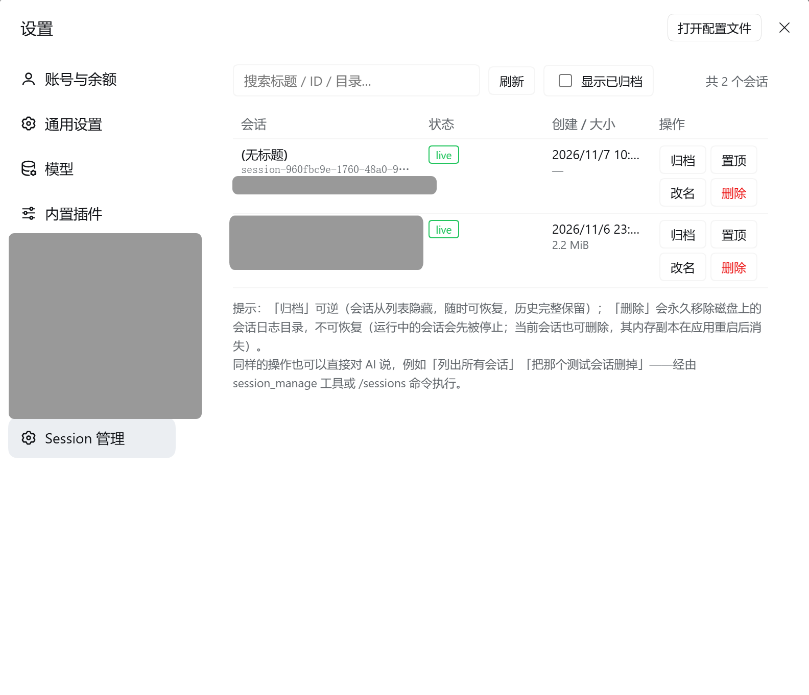
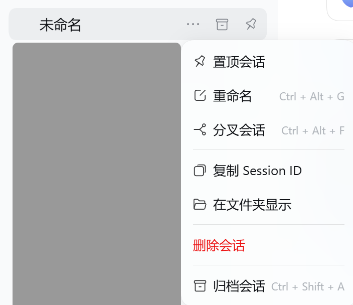

# dsh-session-management

> [English](./README.md) | 简体中文

面向 [DeepSeek Harness](https://github.com/deepseek-ai/deepseek-harness)（`dsh`）的会话管理插件。

列出、归档、置顶、停止、重命名，并**彻底删除**你的 `dsh` 会话 —— 提供四个入口：**设置页**、**侧栏右键菜单**、**`/sessions` 命令**、以及 AI 可调用的 **`session_manage` 工具**。

`dsh` 原生只有「归档」。这个插件补上缺失的那块：真正的删除（把会话日志从磁盘移除），外加一个能看清每个会话大小、状态、日志路径的全局视图。

[](./LICENSE)
[](https://github.com/Chengeat/dsh-session-management)

## 功能

| 操作 | 说明 |
|---|---|
| **list（列表）** | 展示全部会话的标题、ID、cwd、live/cold、是否运行中、置顶、归档、事件数、磁盘大小、日志路径；支持关键词搜索；可选显示已归档。 |
| **archive / unarchive（归档 / 取消归档）** | **可逆** —— 会话从侧栏隐藏，历史完整保留，随时恢复。 |
| **pin / unpin（置顶 / 取消置顶）** | 让会话固定在侧栏顶部。 |
| **stop（停止）** | 打断正在运行的会话当前 turn（等同于用户的停止按钮）。 |
| **rename（改名）** | 更新 live 会话标题（写入会话日志，持久保留）。 |
| **delete（彻底删除）** | 从磁盘永久移除会话日志目录。**不可逆** —— 所有入口都要求显式确认。运行中的会话会先被停止。**当前会话也允许删除**，其内存副本在应用下次重启后消失。 |

四个入口共用同一个 Host 操作核心，页面、菜单、命令、AI 工具的行为始终一致。界面语言跟随 Harness 的语言设置（英/中实时切换，无需刷新）。

## 截图

### 设置页

**Settings → Session 管理** —— 可搜索的会话表格，每行带操作按钮：



### 侧栏右键菜单

内置会话菜单在「归档会话」上方多出一个红色**删除会话**项：



## 运行要求

- 挂载了 Web GUI 的 `dsh` profile（标准 `dsh web` 组合或 Desktop 均可）。
- 内置 JSONL 会话持久化后端（默认自带）—— 查看冷会话、磁盘大小、以及彻底删除磁盘日志都需要它；没有它时，除 `delete` 外的操作对 live 会话依然可用。
- 针对 `@deepseek-ai/dsh 0.2.2` 编写。插件只通过稳定的 Host 服务注册（工具、命令、slot、右键菜单、HTTP 路由），运行时**不 import** 任何内部包。

## 安装

一条命令装进任意 profile（需要 `PATH` 里有 `pnpm`，可用 `corepack enable pnpm` 开启）：

```sh
dsh plugin --profile <profile名> add github:Chengeat/dsh-session-management
```

例如装进名为 `web` 的 profile：

```sh
dsh plugin --profile web add github:Chengeat/dsh-session-management
```

npm 包名为 **`dsh-session-management-t`**（不带后缀的 `dsh-session-management` 已被 npm 上另一个插件占用）。待该包发布后，也可以按包名安装：

```sh
dsh plugin --profile web add dsh-session-management-t
```

首次从 git 安装时，pnpm 会要求允许安装期构建步骤：按 pnpm 打印出的 `allowBuilds` 键，把它加进该 profile 的 `pnpm-workspace.yaml`，然后重跑上面的命令即可。

或者克隆源码后安装：

```sh
git clone https://github.com/Chengeat/dsh-session-management.git
```

- **在交互式 `dsh` 会话里（推荐）** —— 告诉 AI：
  > 安装 /abs/path/to/dsh-session-management 这个插件 bundle
- **在 Web GUI 里** —— 打开 **Settings → Plugins**，像安装任何 bundle 一样安装本目录。

装完请 **重启 `dsh` 并刷新浏览器页面。** 同时带 Host 与 Client 两半的 bundle 首次安装需要重启，模块图才会加载这两半。

重启后四个入口同时可用：

- **Settings →「Session 管理」** —— 管理页面
- **侧栏右键** —— 内置「归档会话」上方的红色**删除会话**项
- **`/sessions`** —— 斜杠命令
- **`session_manage`** —— AI 工具

> **注意** —— 如果你之前用别的包名（例如 `@local/dsh-session-management`）装过同一份代码，请先移除那个 bundle。两个同时生效的副本都会注册 `session_manage`，激活时会冲突。

## 使用

### 设置页

**Settings → Session 管理**：可搜索的会话表格。每行提供 归档 / 取消归档 / 置顶 / 取消置顶 / 停止 / 改名 / 删除 按钮；删除需点击行内「确认删除」。页面语言跟随 Harness 的语言设置（英/中实时切换，无需刷新）。

### 侧栏右键菜单

在侧栏任意会话行上右键，菜单会在内置「归档会话」上方多出一个红色项：

> **删除会话** ← 本插件新增
> 归档会话  `Ctrl + Shift + A`

点击后弹出确认提示条，按 **「确认删除」** 才永久移除日志。

### 斜杠命令

```
/sessions list [关键词]
/sessions archived
/sessions archive <id>
/sessions unarchive <id>
/sessions pin <id>
/sessions unpin <id>
/sessions stop <id>
/sessions rename <id> <新标题>
/sessions delete <id> confirm
```

`delete` 不带末尾的 `confirm` 会拒绝执行。`archive` / `pin` / `stop` 省略 id 时作用于当前会话。

### AI 工具

直接对 AI 说即可：

> "列出所有会话"
> "把测试会话 `29d374e3` 删了" —— AI 会以 `confirm="confirm"` 调用 `session_manage`

工具签名：`session_manage(action, sessionId?, title?, confirm?, query?, includeArchived?, stop?)`。

## 原理

插件通过 `dsh` 已有服务组合实现，不绕过框架：

| 事项 | 使用的服务 |
|---|---|
| 会话枚举 + 标题 | `sessionQuery.listSessions()`（live 优先）、`readTitleSnapshots()` |
| 归档 / 置顶状态 | `workspaceRegistry.archiveSession/unarchiveSession/pinSession/unpinSession`、`archivedSessionIds`、`pinnedSessionIds` |
| 停止 | `ctx.agents.get(id)` → `agent.cancel({ kind: 'user' })` |
| 改名 | `sessionTitle.rename(session, title)` —— 一条持久标题事件 |
| 删除 | `sessionPersistence.list()` → 每个已存会话的 `location.path`（例如 `~/.dsh/sessions/--<cwd>--/<id>/session.v4.jsonl.zstd`），校验文件名形状后删除整个会话目录。持久层没有 delete API，所以这是刻意加了守卫的直接文件移除。 |
| 页面通道 | 挂在 Harness webserver 上的 JSON API `/dsh-session-management/api`，带同源（`Origin`/`Host`）检查 |
| 侧栏菜单 | `contextMenus.register({ target: 'session' })`，两步确认走宿主 toast |

会话 ID 是不透明值 —— 有些是不带 `session-` 前缀的裸 UUID。插件始终使用列表返回的原样 ID，绝不改写。

## 目录结构

```
dsh-session-management/
  package.json          # dsh bundle 清单（patch + client 声明）
  cordis.patch.yml      # 插入 session-management 插件行
  index.js              # Host 半区：操作核心、session_manage 工具、/sessions 命令、JSON API
  client.js             # Client 半区：设置页 + 侧栏菜单项（React，纯 JS 无构建）
  icon.svg              # bundle 图标
  locale/en.json        # meta.title / meta.description（英文）
  locale/zh.json        # meta.title / meta.description（中文）
  screenshots.json      # 市场截图清单（见 awesome-dsh-plugin 约定）
  screenshot/           # 上文截图（EN-*.png 英文界面，CH-*.png 中文界面）
  README.md             # 英文文档
  README-zh.md          # 本文件
  LICENSE               # MIT
```

## 安全说明

- **删除不可逆。** 它移除的是持久日志，没有撤销、没有回收站。所有路径都要求显式确认（`confirm="confirm"` / 行内确认 / toast 确认）。
- 插件允许删除你当前所在的会话 —— 这是设计行为，需要确认。
- JSON API 拒绝跨源与跨站请求。

## 许可

MIT —— 见 [LICENSE](./LICENSE)。
