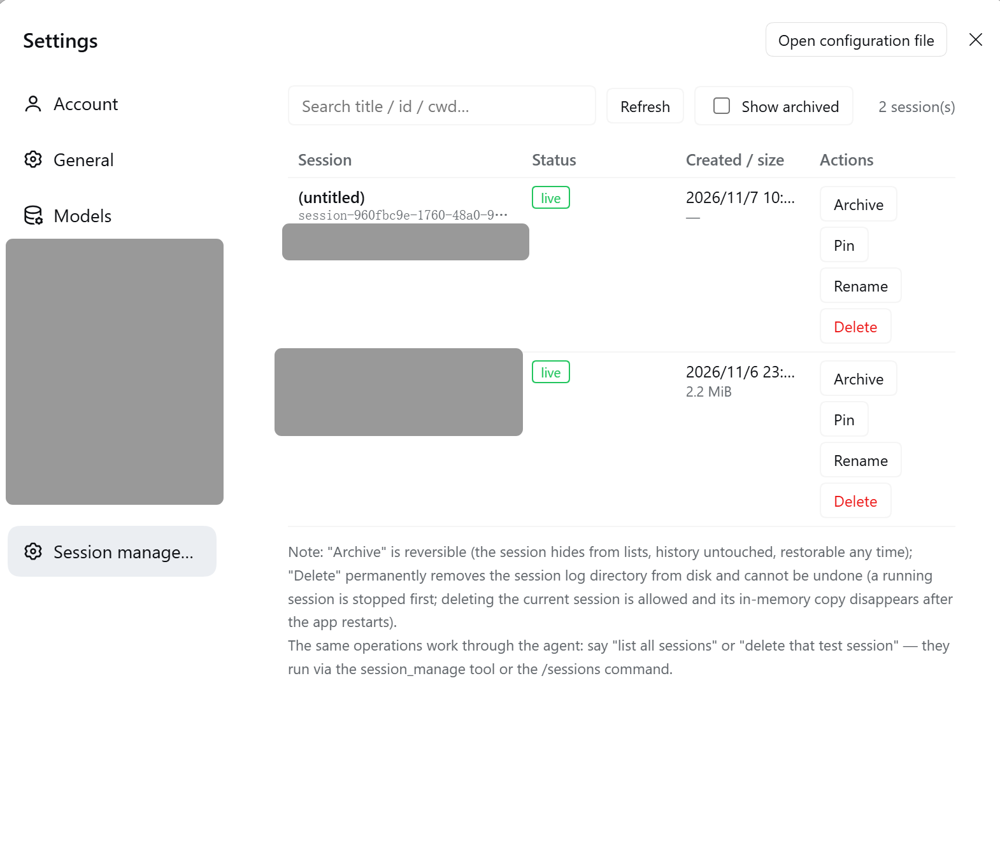
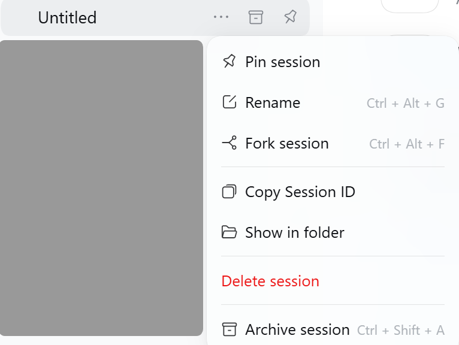

# dsh-session-management

> English | [简体中文](./README-zh.md)

A session-management plugin for the [DeepSeek Harness](https://github.com/deepseek-ai/deepseek-harness) (`dsh`).

List, archive, pin, stop, rename, and **permanently delete** your `dsh` sessions — from a **Settings page**, the **sidebar right-click menu**, the **`/sessions` command**, or the **`session_manage` tool** the AI can call for you.

`dsh` only ships *Archive* for sessions. This plugin adds the missing part: a real delete (removes the session log from disk), plus a bird's-eye view of every session with its size, status, and log path.

[](./LICENSE)
[](https://github.com/Chengeat/dsh-session-management)

## Features

| Action | What it does |
|---|---|
| **list** | Every session with title, id, cwd, live/cold, running, pinned, archived, event count, on-disk size, and log path. Text search, optional "show archived". |
| **archive / unarchive** | Reversible — hides a session from the sidebar without touching its history. |
| **pin / unpin** | Keep sessions at the top of the sidebar. |
| **stop** | Interrupt a running session's current turn (same as the user's stop button). |
| **rename** | Update a live session title (written to the session log, durable). |
| **delete** | Permanently remove the session log directory from disk. **Irreversible** — every entry point requires an explicit confirmation. A running session is stopped first. Deleting the *current* session is allowed; its in-memory copy disappears on the next app restart. |

All four entry points share one operation core in the Host, so the page, the menu, the command, and the AI tool always behave identically. The UI follows the Harness language setting (English / 中文 switch live, no reload).

## Screenshots

### Settings page

**Settings → Session management** — searchable table with per-row actions:



### Sidebar right-click menu

The built-in session menu gains a red **Delete session** item above Archive:



## Requirements

- A `dsh` profile with the Web GUI (the standard `dsh web` composition or Desktop).
- The shipped JSONL session-persistence backend (the default) — needed to see cold sessions, disk sizes, and to delete stored logs. Without it, everything except `delete` still works on live sessions.
- Built against `@deepseek-ai/dsh 0.2.2`. The plugin registers only through stable Host services (tools, commands, slots, context menus, web routes) and imports **no internal packages** at runtime.

## Install

One command, into any profile (`pnpm` must be on `PATH` — `corepack enable pnpm`):

```sh
dsh plugin --profile <profile-name> add github:Chengeat/dsh-session-management
```

For example, to install into the profile named `web`:

```sh
dsh plugin --profile web add github:Chengeat/dsh-session-management
```

The npm package name is **`dsh-session-management-t`** (the un-suffixed `dsh-session-management` is already taken on npm by another plugin). Once it is published, install by name instead:

```sh
dsh plugin --profile web add dsh-session-management-t
```

The first install of a git-hosted plugin asks pnpm to allow its install-time build step: when pnpm prints an `allowBuilds` key, add that exact key to the profile's `pnpm-workspace.yaml` and re-run the command.

Or install from a checkout:

```sh
git clone https://github.com/Chengeat/dsh-session-management.git
```

- **From an interactive `dsh` session (recommended)** — tell the AI:
  > install the plugin bundle at /abs/path/to/dsh-session-management
- **From the Web GUI** — open **Settings → Plugins** and install this directory like any bundle.

**Restart `dsh` and refresh the browser page.** A bundle with both a Host and a Client half needs a restart on first install so the module graph picks the halves up.

After the restart you get all four surfaces at once:

- **Settings → "Session management"** — the management page
- **Sidebar right-click** — a red **Delete session** item above the built-in Archive
- **`/sessions`** — the slash command
- **`session_manage`** — the agent tool

> **Note** — if you previously installed a copy of this plugin under another name (e.g. `@local/dsh-session-management`), remove that bundle first. Two active copies both registering `session_manage` collide at activation.

## Usage

### Settings page

**Settings → Session management**: a searchable table of every session. Each row carries Archive / Unarchive / Pin / Unpin / Stop / Rename / Delete buttons; Delete needs an in-row "Confirm delete". The page language follows your browser (English / 中文).

### Sidebar menu

Right-click any session row in the sidebar — the menu gains a red **Delete session** row above the built-in Archive:

> … **Delete session** ← added by this plugin
> Archive session  `Ctrl + Shift + A`

Selecting it raises a confirmation toast — press **Confirm delete** to remove the log permanently.

### Slash command

```
/sessions list [filter]
/sessions archived
/sessions archive <id>
/sessions unarchive <id>
/sessions pin <id>
/sessions unpin <id>
/sessions stop <id>
/sessions rename <id> <new title>
/sessions delete <id> confirm
```

`delete` refuses to run without the trailing `confirm`. An empty id for `archive` / `pin` / `stop` acts on the current session.

### Agent tool

Just talk to your agent:

> "list all my sessions"
> "delete the test session `29d374e3`" — the AI runs `session_manage` with `confirm="confirm"`

Tool: `session_manage(action, sessionId?, title?, confirm?, query?, includeArchived?, stop?)`.

## How it works

The plugin composes with existing `dsh` services instead of reaching around them:

| Concern | Service used |
|---|---|
| Session enumeration + titles | `sessionQuery.listSessions()` (live-preferred), `readTitleSnapshots()` |
| Archive / pin state | `workspaceRegistry.archiveSession/unarchiveSession/pinSession/unpinSession`, `archivedSessionIds`, `pinnedSessionIds` |
| Stop | `ctx.agents.get(id)` → `agent.cancel({ kind: 'user' })` |
| Rename | `sessionTitle.rename(session, title)` — a durable title event |
| Delete | `sessionPersistence.list()` → each stored session's `location.path` (e.g. `~/.dsh/sessions/--<cwd>--/<id>/session.v4.jsonl.zstd`); the plugin removes that whole session-owned directory after checking the artifact name shape. The persistence seam has no delete API, so this is an intentionally guarded direct removal. |
| Page transport | a JSON API served at `/dsh-session-management/api` on the Harness webserver, guarded by a same-origin (`Origin`/`Host`) check |
| Sidebar menu | `contextMenus.register({ target: 'session' })` with a two-step confirm via the host toast |

Session ids are opaque — some are plain UUIDs without the `session-` prefix. The plugin always uses the exact id the list reported and never rewrites it.

## Repository layout

```
dsh-session-management/
  package.json          # dsh bundle manifest (patch + client declaration)
  cordis.patch.yml      # inserts the session-management plugin row
  index.js              # Host half: admin core, session_manage tool, /sessions command, JSON API
  client.js             # Client half: Settings page + sidebar menu action (React, plain JS)
  icon.svg              # bundle icon
  locale/en.json        # meta.title / meta.description (English)
  locale/zh.json        # meta.title / meta.description (中文)
  screenshots.json      # storefront screenshot manifest (see awesome-dsh-plugin)
  screenshot/           # the images above (EN-*.png English UI, CH-*.png 中文 UI)
  README.md             # this file
  README-zh.md          # 中文文档
  LICENSE               # MIT
```

## Safety notes

- **Delete is irreversible.** It removes the durable log; there is no undo and no trash. Every path requires explicit confirmation (`confirm="confirm"` / in-row confirm / toast confirm).
- The plugin can delete the session you are currently in — by design, with confirmation.
- The JSON API refuses cross-origin and cross-site requests.

## License

MIT — see [LICENSE](./LICENSE).
